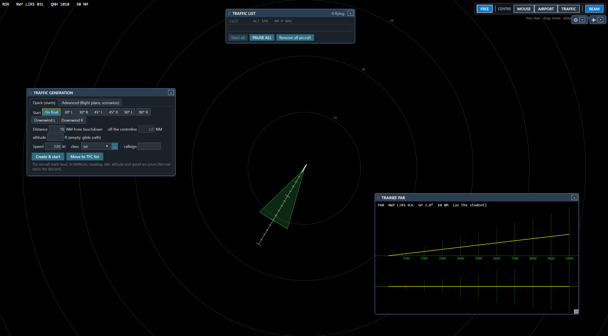
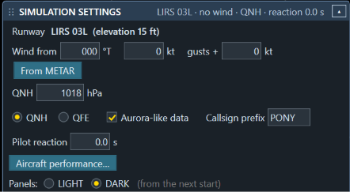
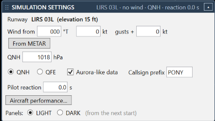

# AuroraPAR v2 Trainer — Instructor+ guide

The Trainer is AuroraPAR v2 with two additions for lessons: the surveillance radar **RDR** (a plan view with
maps) and the **Instructor+** (an instructor's station that flies simulated aircraft for the student). The maps are
made by **ATCRoom Map Creator**, a separate download ([ATCRoom/MapCreator](https://github.com/ATCRoom/MapCreator/releases)). Everything about the PAR itself (views, labels, settings, profiles,
runways) is in the [AuroraPAR v2 manual](MANUAL.md) (`MANUAL.md`, also beside the program). Step by step: the
[tutorials](tutorials/README.md). Website: <https://atcroom.github.io/AuroraPAR-v2/trainer.html>.

The simulated aircraft are never sent to IVAO: they exist only in the Trainer. The flight is computed by the
Instructor+ with its own performance table; the student's PAR shows the aircraft as normal traffic, with **SIM
TRAFFIC** at the top of the views.

## Contents

1. [Opening the Instructor+](#1-opening-the-instructor)
2. [The window and the floating panels](#2-the-window-and-the-floating-panels)
3. [The radar of the instructor](#3-the-radar-of-the-instructor)
4. [Commands on the label](#4-commands-on-the-label)
5. [Routes on the radar](#5-routes-on-the-radar)
6. [SETTINGS](#6-settings)
7. [TRAFFIC GENERATION](#7-traffic-generation)
8. [TRAFFIC LIST](#8-traffic-list)
9. [AIRCRAFT CONTROL](#9-aircraft-control)
10. [TRAINEE PAR](#10-trainee-par)
11. [Aircraft performance](#11-aircraft-performance)
12. [Keys and macro keyboard](#12-keys-and-macro-keyboard)
13. [A lesson on one PC](#13-a-lesson-on-one-pc)
14. [A lesson between two PCs](#14-a-lesson-between-two-pcs)
15. [Session, log, traces and photos](#15-session-log-traces-and-photos)

---

## 1. Opening the Instructor+

Button **Instructor+ (⇧I)** in the main window, or **Shift+I**. Closing its window removes the simulated aircraft
(the flight plans are lost too: save a scenario first if you want to keep them).

## 2. The window and the floating panels

The instructor's radar fills the whole window. Over it float five panels:

[](images/trainer-instructor.png)


| Panel | What it is for |
| --- | --- |
| **SETTINGS** | runway, wind, QNH / QFE, pilot reaction, callsign prefix, Aircraft performance… |
| **TRAFFIC GENERATION** | new aircraft: Quick starts, flight plans, scenarios, the route editor |
| **TRAFFIC LIST** | the aircraft flying and those waiting to start; Start all, PAUSE, Remove all aircraft |
| **AIRCRAFT CONTROL** | the commands of the selected aircraft |
| **TRAINEE PAR** | the student's PAR in small, to follow the approach |

- **Move** a panel by dragging its blue bar; **▴** closes it: it is parked at the top, as a small box with
  its symbol (⚙ ✎ ✈ ☰ ⊿; its name under the mouse), **▾** there (or a double click) opens it again where it was.
  The boxes stand in a row on the left of the CENTRE bar.
- **Panels: LIGHT / DARK** (in SETTINGS): the look of the inside of the panels and of the Aircraft
  performance window. LIGHT (the default) is Windows' own; DARK makes the boxes, lists, buttons and tables dark, easier
  on the eyes in a dim room. It changes at the next start of the program.

  [](images/trainer-panels-dark.png)
  [](images/trainer-panels-light.png)

- **Double-click on the bar**: back to its first place.
- A panel always stays inside the window; when its content is taller than the room under it, it scrolls.
- The TRAINEE PAR is **resized** from its bottom right corner.
- Places, open / closed and the size of the TRAINEE PAR are kept for the next time.
- A click on a panel brings it in front of the others.

## 3. The radar of the instructor

> **⚠ Personal use only — simulation only.** The maps you make with ATCRoom Map Creator (from IVAO, VATSIM, AIP
> or other files) are **for your own use only**: **do not distribute them** (no sharing, no uploading) without the permission of the owner of the data. They are for flight simulation and training on AuroraPAR only and
> **must never be used for real-world navigation or air traffic control**.

- **Wheel**: range. **CENTRE** (top right): **MOUSE** (the wheel zooms at the pointer, the right button drags the
  view, a double-click goes back to the airport), **AIRPORT** (centred on the airport), **TRAFFIC** (the selected
  aircraft always in the middle).
- **FREE** (left of CENTRE): no centre, the view stays where you leave it. Drag it with the left button (the right one
  works too), the wheel zooms at the pointer; no double-click (AIRPORT goes back to the airport). Clicks on tracks,
  labels and route points work as usual; while adding points by click, a still click adds a point and a drag moves
  the view. The RDR of the student has FREE too.
- **BEAM** (beside CENTRE, on / off, kept): where the student's PAR sees the aircraft, seen from above. Filled: the
  azimuth beam; dashed: the azimuth scan limits; from the antenna (middle of the runway) to the end of the range. It
  follows the antenna when the student tilts it. Useful to place the aircraft of a scenario just outside the beam, so
  the student sees them come in. The height limits are not in a plan view: see them in the TRAINEE PAR.
- **Click on a track** (or on its label): selects the aircraft.
- **Labels**: drag them with the left button (a line joins them to the track); double-click: back to their place.
- Range rings around the airport, the maps chosen with **Maps…** of the RDR, the other airports of `runways.par`
  in grey.
- Aircraft **waiting** in the TRAFFIC LIST: a grey dashed square where each will start, with its name, and its route
  dim. The student does not see them.

## 4. Commands on the label

The selected aircraft has a larger label that commands it by itself: a line per command, its small grey name, the
value given in blue, then its keys.

```
PONY01 J  MANUAL
NOW 025↓  220kt  -720fpm
HDG 243 [◀ 1][1 ▶][FINAL CRS]
TURN [◀][■][▶] [3][1.5][F]
     continuous turn (no-gyro)
ALT 020
VS  -700 [▲ 50][▼ 50][NORMAL][STOP][G/A]
SPD 220 [SLOW]
NAV →ALFA [NEXT WPT]
```

- **NOW**: altitude now (hundreds of ft) with ↑↓, speed and vertical speed now.
- **HDG**: the heading given, ◀ 1 / 1 ▶ (1° at a time), **FINAL CRS**.
- **TURN**: the **continuous turn** for the no-gyro approach: ◀ turns left, ▶ turns right, at the rate chosen (**3**,
  **1.5** °/s or **F** free, the one chosen in blue), and the turn goes on until ■ (**STOP TURN**, orange) or a heading.
  The side turning is yellow.
- **ALT**: the altitude given. **VS**: the rate given, ▲ / ▼ (the step of **Keys…**), **NORMAL** (the glide path, blue
  while flown), **STOP** (levels off) and **G/A** (go around), both orange.
- **SPD**: the speed given, **SLOW** (the final speed of the class). **NAV**: the next point, **NEXT WPT**.

- **Click on a value** (heading, cleared altitude, speed, point, rate): a list opens beside it, with the value now in
  the middle; a click (or the arrows
  and Enter) gives the value; or type it and press **Go**; **Esc** closes. The lists have their buttons too:
  ◀5 / 5▶, STOP TURN, Final CRS (heading); STOP CLIMB / DESCENT (altitude); Normal, STOP (rate); **Final (n)** (speed:
  the final speed of the class); Next WPT, MANUAL, Edit route… (point).
- **Wheel over a value**: one step (heading 5°, altitude 100 ft, speed 5 kt, rate 100 ft/min).
- **Right click on an aircraft** (label or track): Pause / Unpause, Reactivate, ROUTE / MANUAL, Edit route…, Rename…,
  Hide label, Remove.

All commands are carried out after the **pilot reaction** (SETTINGS), as real pilots are not instantaneous.

## 5. Routes on the radar

- **Add by click** (route editor): a click on the radar adds a point when the button is let go. Near a point of the
  maps (VRP, FIX, VOR, NDB, airport) a menu asks: that point (it takes its exact place and name) or a **GPS point**
  (bearing / distance from the threshold). Far from everything: the GPS point at once.
- **Drag a point** of the selected route (the flight plan being made, or the selected aircraft, also while it flies):
  the cursor becomes ✥ over a point. The drop has the same menu near a map point. Altitude and speed of the point
  stay. If the aircraft is flying to that point, it turns at once to the new place.
- **Right click on a point**: **Remove WPT**; for an aircraft also **Direct to this point** and **Edit route…**.

## 6. SETTINGS

On its bar: a summary (runway, wind, QNH / QFE, reaction). Inside:

- **Runway**: the one of the radar (while no simulated aircraft fly; while they fly it stays, so they stay where they
  are if the student changes runway).
- **QNH / QFE** (the altitudes typed and shown), **Aurora-like data** (positions every half second and altitude in
  steps, as from Aurora), **Callsign prefix** (SIM → SIM1, SIM2…).
- **Wind**: from (degrees true, as in the METAR; the magnetic value beside it), speed, gusts; **From METAR** copies
  the wind of the METAR received from Aurora.
- **Pilot reaction**: 0–5 s.
- **Speed**: x1 / x2 / x4, only outside a session (START SESSION puts it back to x1).
- **Go around to**: the height above the threshold the GO AROUND climbs to (500–10000 ft, 2000 at first).
- **Appearance**: the panels LIGHT / DARK (from the next start). **Network**: My callsign and My VID for the log.
- **Aircraft performance…**: see [11](#11-aircraft-performance).

## 7. TRAFFIC GENERATION

**Quick (starts)**: an aircraft at once from a start: **On final**, **30° / 45° / 90°** from the left or the right
(aimed at the point of the centreline at the distance), **Downwind L / R**. Distance from touchdown, distance off the
centreline, altitude (empty: on the glide path), speed, class (**…** opens Aircraft performance), callsign (empty: the
next free one). Then:

- **Create & start**: it starts flying now, level, in MANUAL;
- **Move to TFC list**: it waits in the TRAFFIC LIST until you start it.

**Advanced (flight plans, scenarios)**:

- **New FPL** makes a plan (callsign, class); its route in the **route editor** below: points by click on the radar,
  by the name of a map point, or by bearing and distance from the threshold; each with an altitude and a speed
  (empty: kept). The first point needs both: the aircraft starts there.
- **Duplicate** copies the selected plan with the next number (AZA101 → AZA102); **Remove FPL**; **Remove all FPLs**
  (after a question; also those waiting in the TRAFFIC LIST; aircraft already flying go on).
- **TFC LIST** (beside each plan) puts it in the TRAFFIC LIST, waiting; **ALL TO TFC LIST** all of them.
- **Save scenario… / Load scenario…**: all the plans in a file (folder `Scenarios` beside the settings). A scenario
  keeps the name of the class of each plan: a class that is missing on another computer becomes the Jet.

## 8. TRAFFIC LIST

- **Flying**: callsign, altitude (↑↓), speed, distance from touchdown, **P** (● seen by the student's PAR, ○ not
  seen), navigation. A click selects the aircraft for AIRCRAFT CONTROL. On each row: **II / ▶** (pause / unpause only
  this aircraft), **↺** (an aircraft of a flight plan starts again from its first point), **✕** (remove).
- **WAITING**: the aircraft sent with TFC LIST or Move to TFC list. **▶** starts one, **✕** takes it out (a flight
  plan waits again in TRAFFIC GENERATION). A click on a flight plan shows its route in the editor.
- **Start all**: all the waiting aircraft start.
- **PAUSE / RUN**: the whole simulation stops and goes on.
- **Remove all aircraft**: flying and waiting, after a question (the flight plans wait again); a PAUSE is ended,
  so the next aircraft started move at once.

## 9. AIRCRAFT CONTROL

The selected aircraft's callsign is on the bar. The information (class, distance, ground speed, altitude, what is
waiting for the pilot) and the readouts **BEST VS** (the vertical speed of the glide path at its ground speed — what
Normal gives), **VS**, **TURN**, **HDG**, **DRIFT**. Then a row for each command:

| Row | Commands |
| --- | --- |
| **HDG** | ◀ / ▶ (1°, held: repeats), the heading box, **Go** (or Enter), **Final CRS**; the turn rate **3° / 1.5° / FREE** |
| *Continuous turn (no-gyro approach)* | **◀ TURN LEFT**, **STOP TURN** (orange), **TURN RIGHT ▶**: a turn at the rate chosen that goes on until STOP TURN or a heading; the side turning is yellow and the heading box follows the turn |
| **RATE** | ▲ / ▼ with their step (the one of **Keys…**, the same on the label and for the keys), **Normal** (the glide path), **STOP** (orange: levels off where it is) |
| **ALT** | the altitude (ft QNH or QFE) and **rate** (ft/min, 100–6000, wheel 100 / Shift 500; changed while climbing or descending: at once), **Go** or Enter |
| *colours* | **Final CRS**, **Normal**, **Slow dwn to final** light blue: the commands that put the aircraft on the approach; **green** while done (on the final course, on the glide path, at the final speed). Orange: the urgent ones (STOP, STOP TURN, GO AROUND) |
| **G/A** | **GO AROUND** (orange): the aircraft climbs straight ahead to the go-around altitude (SETTINGS: feet above the threshold); in the log GO AROUND, or MISSED APPROACH after the minimums |
| **SPD** | speed, **Go**, **Slow dwn to final** (the final speed of the class) |
| **NAV** | **MANUAL / ROUTE**, **Next WPT**; → a point of the route or of the maps, **Go**, **Route…** (Edit route) |
| **STICK** | **Show / Hide** the stick, **Joystick…** (a real joystick or gamepad) |
| **NAME** | **Rename** |

- **MANUAL**: the aircraft flies the headings you give (and the stick); a route, if any, is kept.
- **ROUTE**: it flies the points of its route; the route's altitudes and speeds are flown until you give one.
  A heading (or the stick sideways) puts it back in MANUAL at once.
- **Keys…** (on the bar) or **F12**: see [12](#12-keys-and-macro-keyboard).

## 10. TRAINEE PAR

The student's PAR in small: the same runway, glide path and range, linear scales, the tracks with a few dots, the
selected aircraft with a yellow square; a click on a track selects it. The **decision height**: an orange dashed line
with **DH**, and a mark where the glide path reaches it (the missed approach point). The labels of the simulated aircraft are
**orange** (here and on the radar of the Instructor+, never on the student's screens), the real IVAO traffic white.
Aircraft that the student's PAR **does not see**
(outside its beams) are **grey** with "not seen"; when they come into the beam they become green, at the same moment
they appear to the student.

## 11. Aircraft performance

**Aircraft performance…** (SETTINGS) or **…** beside a Class box: a table with a row for each class.

| Column | Meaning |
| --- | --- |
| Min / Max speed | lowest and highest speed an instruction can give (kt) |
| **Initial speed** | put in the Speed box when the class is chosen (and in the first point of a new flight plan) |
| **Final speed** | the speed of **Slow dwn to final** |
| Max climb / descent | ft/min |
| Accel. / Decel. | how fast the speed changes (kt per second) |
| Vert. accel. | how fast the vertical speed changes (ft/min per second) |
| Max bank | bank limit of the turns (degrees) |

Type in a cell, or turn the **wheel** over it (Shift: bigger steps). **Add class**, **Duplicate** (e.g. a slower Jet),
**Remove**, **Reset to defaults**. **Save** checks the values (min ≤ final ≤ initial ≤ max, names not repeated): a
wrong value is said and nothing is saved. The values are saved in `performance.json` beside the program and are used
for the aircraft created from then on; those flying keep theirs.

Default classes (the Instructor+ proposes the **Jet**):

| Class | Min | Final | Initial | Max |
| --- | --- | --- | --- | --- |
| Light | 60 | 70 | 90 | 160 |
| Turboprop | 90 | 110 | 140 | 280 |
| Jet | 120 | 140 | 180 | 350 |

## 12. Keys and macro keyboard

**Keys…** gives a key to each command of the selected aircraft (heading left / right by a step, Final CRS, rate up /
down by a step, Normal rate, Stop turn, Stop climb / descent, MANUAL / ROUTE, Next WPT, Slow dwn to final, Next
aircraft, PAUSE) and chooses the steps of the heading and rate keys. Click **Assign**, then press the key (or turn
the knob of a macro keyboard). These keys work while the Instructor+ window is in front, also while typing in a field:
choose keys that are not used for typing. The defaults are **F13–F21**, made for a macro keyboard of 6 keys and a knob
(program the macro keyboard with its own software to send those keys).

Fixed keys: **N** next aircraft, **Shift+N** previous aircraft (not while typing in a field).

**F12** (the list of the keys) and **N** / **Shift+N** (next / previous aircraft) are fixed: Keys… does not give them to
a command.

## 13. A lesson on one PC

With two monitors: the student's AuroraPAR on one (PAR or RDR, key **R**), the Instructor+ on the other. One mouse
and one keyboard for two people: the instructor works with the mouse on the Instructor+, the student gives the
instructions by voice. For instructor and student on two computers, also far away, see the next section.

## 14. A lesson between two PCs

The Instructor+ on the instructor's PC, the PAR and RDR on the student's PC, linked through the internet: the same
public relays as the coordination panel (encrypted connection, nothing to install, no port to open). Both PCs run
**AuroraPAR v2 Trainer**. Talk to each other as usual (Discord, TeamSpeak, phone…).

1. **Instructor:** **LESSON** (on the bar at the top left of the Instructor+, or **Lesson…** beside Coordination) →
   **START LESSON**: a new code is made (**COPY CODE** copies it). Tell the code to the student.
2. **Student:** **Lesson…** → write the code → **JOIN** (**LEAVE** ends it).

When the public relays are slow or blocked: **Direct (VPN or home network)** in the same window, on both PCs; the
student also writes the instructor's IP address. Step by step: [VPN.md](VPN.md).
3. The Lesson key turns blue on both PCs when they are linked (orange while waiting). The plan view of the
   Instructor+ shows `LESSON <code>: STUDENT LINKED`.

What travels, about twice a second:

- **To the student:** the simulated aircraft, the QNH of the instructor (used only when the student has no Aurora)
  and the wind of the simulation; aircraft removed or started again also lose their tracks on the student's PC.
  **The maps** of the student's airport from the instructor's Maps folder: they arrive in pieces at the start (a few
  seconds), are shown on the student's RDR in place of his own maps of that airport and are kept **in memory only**:
  never saved on the student's PC, gone at the end of the lesson. His **Maps...** window still chooses what to show
  and the colours.
- **To the instructor:** also the student's **callsign and VID** for the log (from his Aurora and IVAO's list when he
  is connected to IVAO, else the ones typed in his Lesson window).
- **To the instructor:** the student's runway and the beam of its PAR (**BEAM** and **TRAINEE PAR** show what the
  student really sees), which aircraft its PAR sees, and its IVAO traffic.

The Instructor+ follows the **student's runway**. With no simulated aircraft flying it does it by itself; while aircraft
fly it asks whether to remove them and follow (No: they stay, and new aircraft are still made on the old runway; the
question is not repeated for that runway). At a new airport it asks its METAR by itself (from Aurora, or from the
internet). This works the same on one PC. Choose the same airport on the instructor's PC too: for the maps, and because
with Aurora connected the instructor's QNH (sent to a student without Aurora) is the one of the instructor's airport.

The three kinds of lesson:

| Traffic | Instructor's PC | Student's PC |
| --- | --- | --- |
| IVAO only | its Aurora (or the student's IVAO traffic, received) | its Aurora |
| Mixed (IVAO + simulated) | Instructor+; IVAO from its Aurora or received from the student | Aurora connected to IVAO + the simulated aircraft received |
| Simulated only | Instructor+, no Aurora needed | no Aurora needed (STS SIM) |

A new simulated aircraft cannot take the callsign of an IVAO aircraft of either PC.

On the student's PC the Instructor windows do not open while the lesson runs. If the link stops, the simulated
aircraft disappear after 5 seconds, the student's screen shows **LESSON: LINK LOST** and the link comes back by itself;
the simulation goes on on the instructor's PC. **Disconnect** ends the lesson. Whoever has the code can see the
lesson: make a new one for each lesson. Every message is **encrypted with the code**: the relays are public, and
without the code nobody can read the aircraft or the maps. Both PCs need the same version of the Trainer (1.2.0 or
later): older versions do not link with it.

To try it on one PC: two copies of the Trainer in two folders, each with an empty file `AuroraPARTrainer.settings.json`
beside the program (portable mode: each copy keeps its own settings), one as instructor and one as student.

## 15. Session, log, traces and photos

As in TWR Trainer. At the top left of the Instructor+ plan view:

- **PAUSE / RUN** pauses all the aircraft (yellow **RUN** while paused). **Create & start** takes the pause off.
- **LESSON** opens the lesson between two PCs ([14](#14-a-lesson-between-two-pcs)); lit with its code while a lesson is on.
- **IVAO** (last on the bar): the IVAO traffic on the Instructor+ shown (green **● IVAO**: Aurora on IVAO; orange
  **IVAO ?**: Aurora not on IVAO) or hidden (grey: only the simulated aircraft). Aurora stays connected either way:
  the PAR and RDR of the PC keep the IVAO traffic, the QNH and the callsign for the log. Both programs work also without
  IVAO (here STS SIM: the simulated aircraft only).
- **START SESSION** starts the training or the exam: a new **log** (a CSV file in the **Logs** folder: Excel opens it
  in any language), the time from 0:00:00, a new folder of photos. Nothing starts flying. The button shows the time of
  the session; click it again for **END SESSION** (asked first): the summary is written and the simulation paused.
  Closing the Instructor+ or the program ends the session too. With a lesson between two PCs started and the student
  not linked yet, START SESSION asks first. During a session the **speed of the simulation** is x1 (x2 / x4, in
  SETTINGS, only outside a session).
- **PHOTO** saves a picture of the Instructor+ (the simulation goes on) in the **Photos** folder of the session, as
  `Photo-03_T+12m40s.png`, with a row `PHOTO 3` in the log. **📁** opens that folder, **LOGS** the Logs folder.

**The log.** On top: airport, runway, start, network, the callsign and VID of the instructor and of the student
(connected to IVAO: from Aurora and IVAO's list of who is connected; else the ones typed in the **Lesson…** window:
*My callsign and VID*). Then a row per event, with the time of the session: ADDED, APPROACH STARTED (an aircraft
inside the range of the PAR, in front of the runway, flying towards it), ON GLIDE PATH, **AT MINIMUMS** (where the
glide path reaches the decision height: how many feet above or below the glide path, how many feet left or right of
the centreline), LANDING, GO AROUND (a climb before the minimums), MISSED APPROACH (a climb after them), REMOVED; the
instructor's commands that change the flight (HEADING, ALTITUDE, RATE, SPEED, PAUSE, STICK, NAVIGATION) and the pause of
the simulation. At the end a summary per aircraft: approaches, landings, go-arounds, missed approaches, the last
deviation at the minimums.

**The trace of each approach.** At the end of each approach a picture in the folder of the session (beside its log,
same name), named in its row (`Trace-02_PONY21.png`): the **elevation** (height above the threshold, the glide path,
its approach limits and the safety limits as the profile shows them, the decision height) and the **azimuth** (the
centreline, its approach limits where the profile draws them), the white trace of the aircraft and an orange circle
where it reached the minimums. On top: callsign, class, runway, glide path, number of the approach, time and result.

