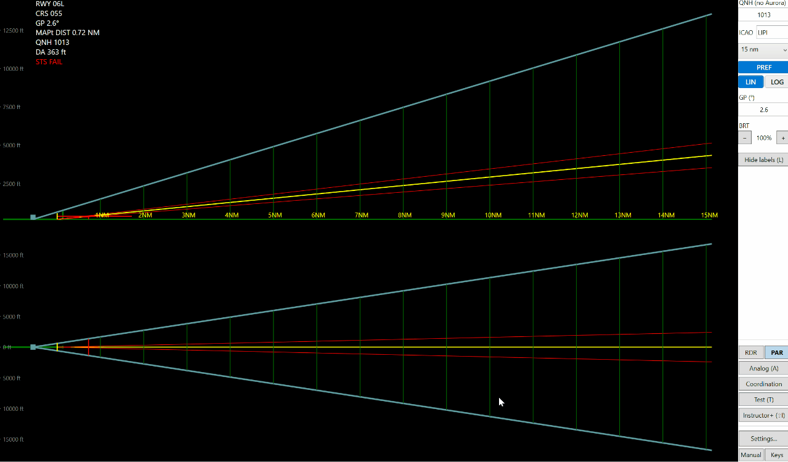
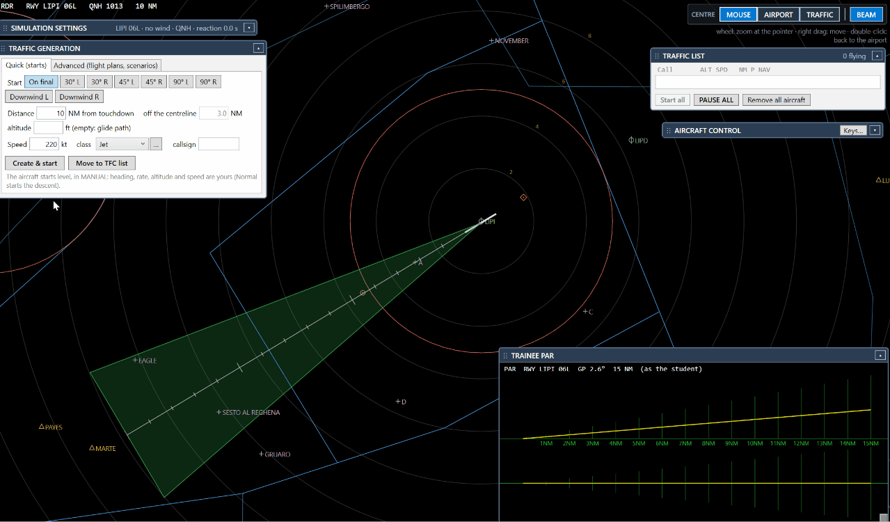

# 1. Your first lesson

Goal: an aircraft on final, flown by you, seen by the student on the PAR. About five minutes.

## Before you start

- Open AuroraPAR v2 Trainer and choose the airport and the runway as usual.
- You can work alone: the student's PAR and your Instructor+ can be on the same PC (two windows).

## Step 1 — Open the Instructor+

Press **Shift+I**, or the button **Instructor+ (⇧I)** in the main window.

The radar of the instructor fills the window. Five panels float over it: **SIMULATION SETTINGS**,
**TRAFFIC GENERATION**, **TRAFFIC LIST**, **AIRCRAFT CONTROL**, **TRAINEE PAR**.

- Drag a panel by its blue bar; **▴ / ▾** folds it to the bar.
- Double-click on a bar: the panel goes back to its first place.
- Put the panels over the "dead" parts of the map: they are remembered.

## Step 2 — Check the settings

In **SIMULATION SETTINGS** look at runway, wind and QNH. Without Aurora connected you type the QNH yourself;
**From METAR** gets wind and QNH from the internet for the airport.

## Step 3 — Start an aircraft with Quick

In **TRAFFIC GENERATION → Quick (starts)**:

1. Choose **On final**.
2. Distance from touchdown: **8 NM**.
3. Leave the altitude empty (on the glide path) and the class on **Jet**.
4. Press **Create & start**.

The aircraft appears on your radar and, as normal traffic, on the student's PAR (with **SIM TRAFFIC** at the top).
**Move to TFC list** would keep it waiting instead (see tutorial 3).

## Step 4 — Follow it

- Click the track (or its label): it is the selected aircraft, its label grows.
- **TRAINEE PAR** shows what the student sees. An aircraft outside the student's beams is **grey** with "not seen".
- **PAUSE ALL** stops everything, **RESUME ALL** goes on.

## Step 5 — Finish

**Remove all aircraft** (TRAFFIC LIST) clears the radar. Closing the Instructor+ window removes the aircraft too.

Next: [create a flight plan](2-flight-plan.md).
