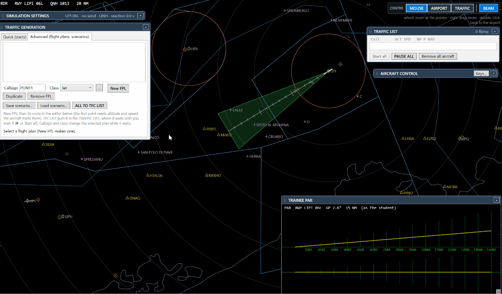
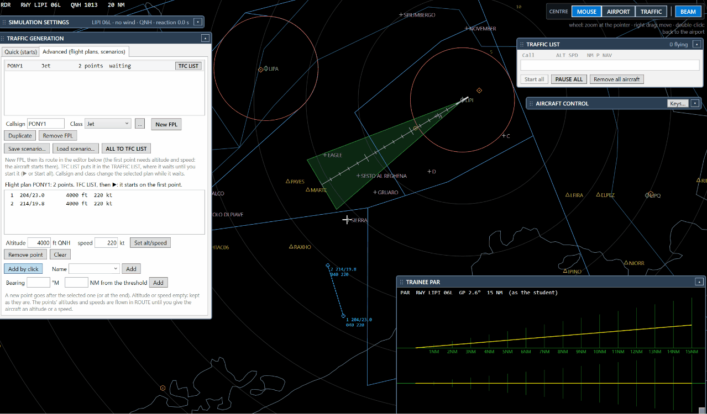
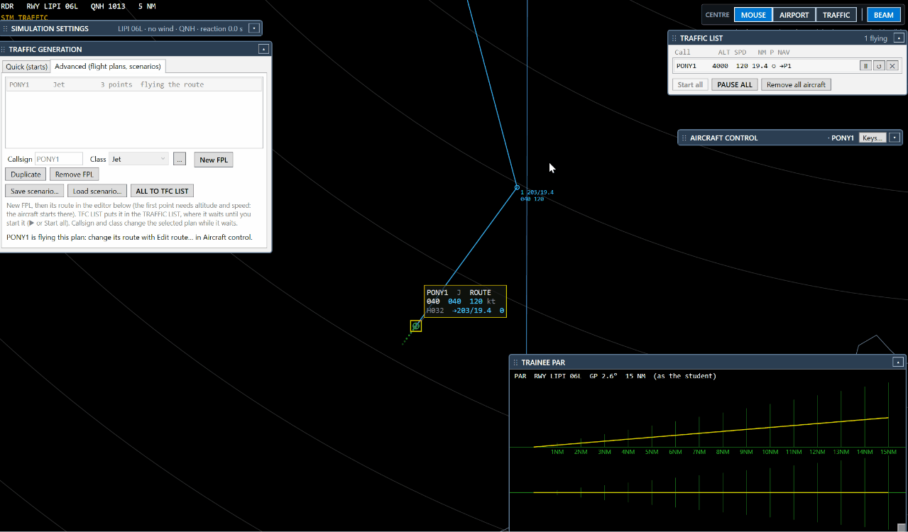
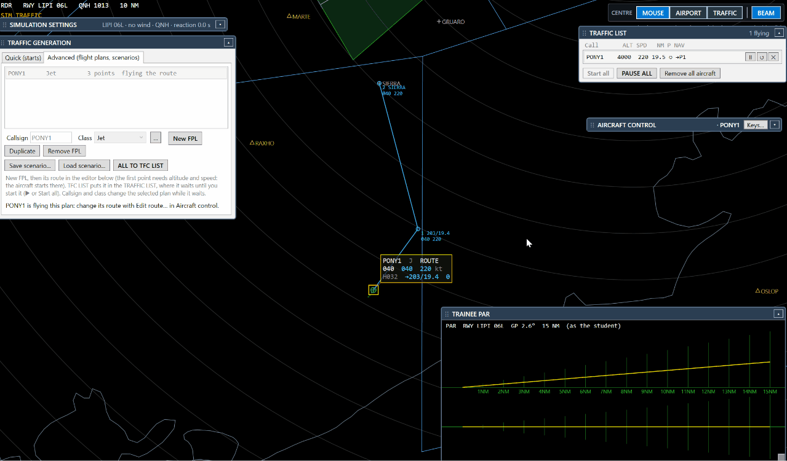

# 2. Create a flight plan

A flight plan (FPL) is a callsign, a class and a route of points. The aircraft starts at the first point and flies
the route.

## Step 1 — A new plan

**TRAFFIC GENERATION → Advanced → New FPL**. Give a callsign (for example `AZA101`) and a class (the Jet is
proposed). The route editor opens below.

## Step 2 — Add points with the mouse

Click on the radar where the aircraft must go; the point is added when you let the button go. The **first point**
is where the aircraft starts: it needs an altitude **and** a speed. For the other points, empty means "keep the
previous one".

## Step 3 — Choose a map point (VRP, FIX, VOR…)

When your click is near a point of the maps, a menu asks:

- the **map point** (it takes its exact place and its name), or
- a **GPS point** (bearing and distance from the threshold).

Far from every map point, the GPS point is added at once.

Points can also be written in the editor: the name of a map point, or bearing and distance from the threshold.

## Step 4 — Move a point by drag and drop

With the plan selected, drag a point with the left button (the cursor becomes ✥). The drop has the same menu near
a map point. This works **also while the aircraft is flying**: if it is going to that point, it turns to the new
place at once.

## Step 5 — Remove a point

Right click on a point → **Remove WPT**. For an aircraft in flight you also have **Direct to this point** and
**Edit route…**.

## Step 6 — Duplicate

**Duplicate** copies the plan with the next number (AZA101 → AZA102): change only what is different.

Next: [build and run a scenario](3-scenario.md).
