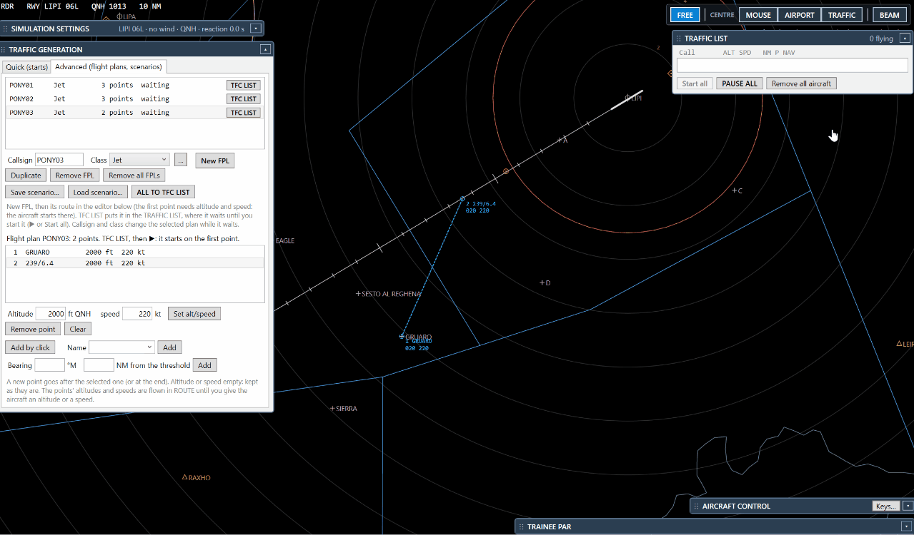
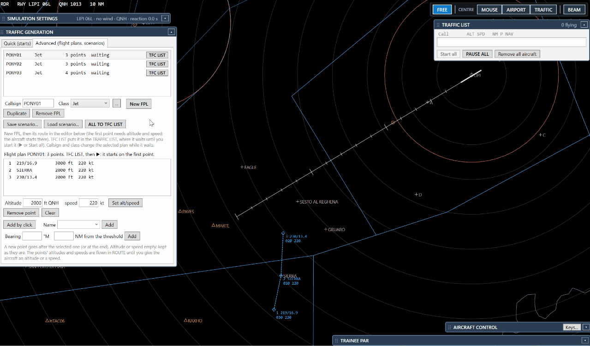
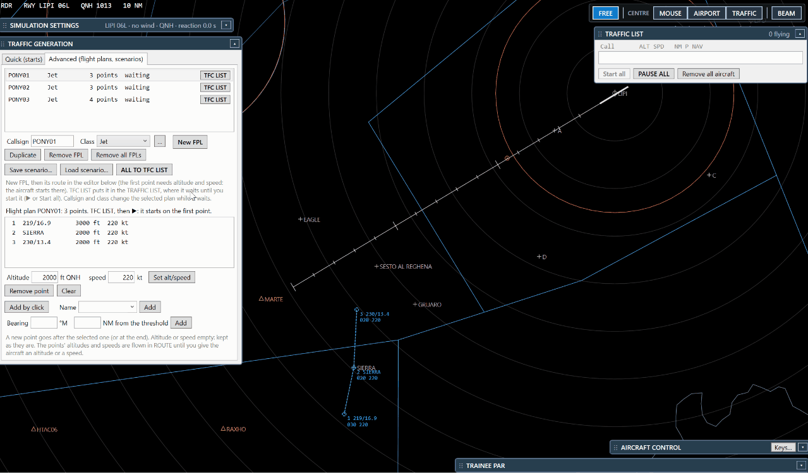

# 3. Build and run a scenario

A scenario is a set of flight plans saved in a file, to repeat the same exercise with different students.

## Step 1 — Make the plans

Create two or three flight plans as in [tutorial 2](2-flight-plan.md). **Duplicate** helps: AZA101, AZA102, AZA103
with different first points, so they arrive one after the other.

## Step 2 — Look at the student's beam

Switch **BEAM** on (beside CENTRE). It draws where the student's PAR sees the aircraft: filled for the azimuth beam,
dashed for the scan limits. Put the first point of each plan **just outside** the beam, so the student sees the
aircraft come in.

## Step 3 — Send the plans to the TFC LIST

Press **TFC LIST** beside a plan, or **ALL TO TFC LIST** for all of them. They appear in **TRAFFIC LIST → WAITING**
and on your radar as grey dashed squares with their names. The student does not see them yet.

## Step 4 — Start

- **▶** on a row starts that aircraft only.
- **Start all** starts all the waiting ones.
- **✕** takes one out of the list (the plan waits again in TRAFFIC GENERATION).

## Step 5 — Save and load

**Save scenario…** keeps all the plans in a file (folder `Scenarios`); **Load scenario…** brings them back, ready
for the TFC LIST. A scenario keeps the **name** of each class: if a class does not exist on another computer, the
Jet is used.

## Step 6 — Run again

**Remove all aircraft** and the plans wait again. The ↺ button on a row starts that aircraft again from its first
point.

Next: [fly the traffic](4-fly-traffic.md).
