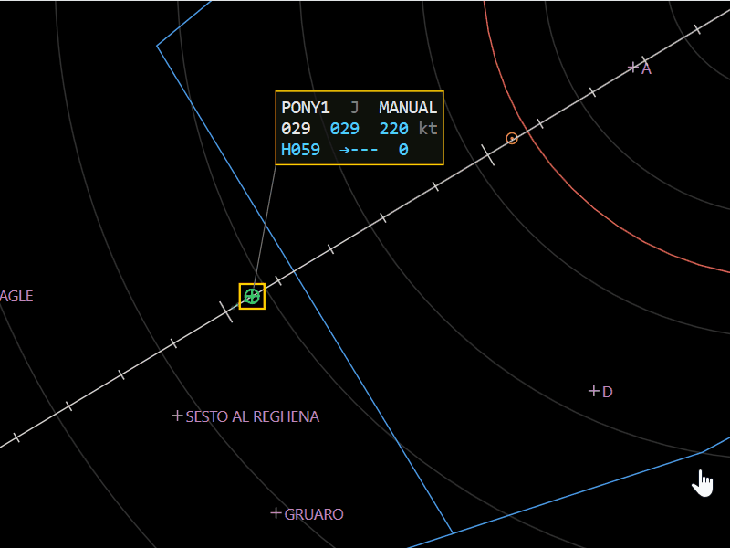
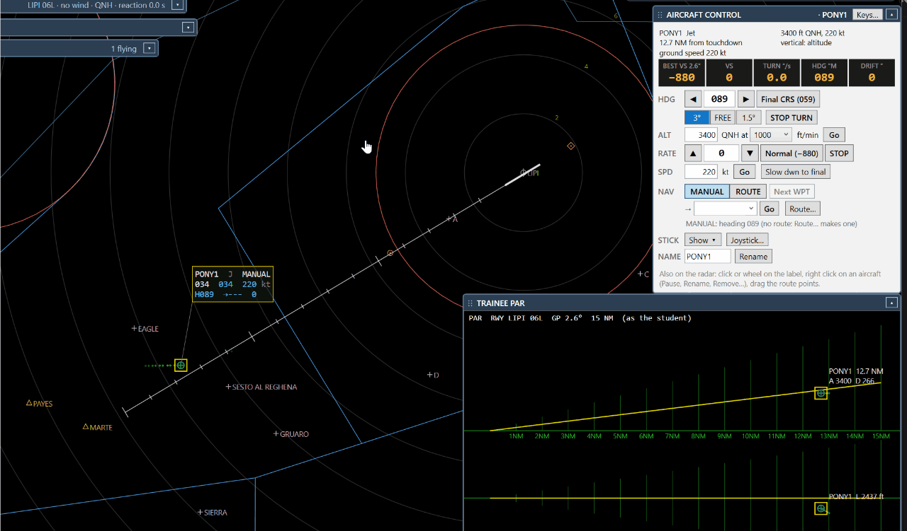
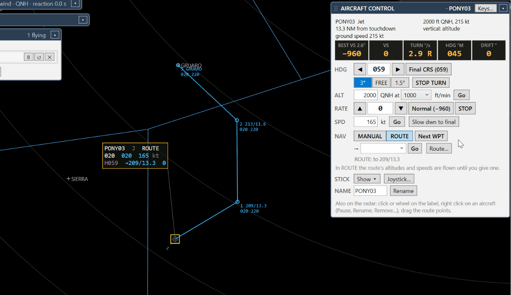

# 4. Fly the traffic

All the commands are carried out after the **pilot reaction** (SIMULATION SETTINGS, 0–5 s), as real pilots are not
instantaneous.

## Step 1 — Commands on the label

The selected aircraft has a larger label with your values in blue:

```
PONY01 J  ROUTE
025↓ 020  220 kt
H243  →ALFA  -650
```

- **Click a value** (heading, altitude, speed, point, rate): a list opens, click a value or type it and press **Go**.
- **Wheel over a value**: one step (heading 5°, altitude 100 ft, speed 5 kt, rate 100 ft/min).
- **Right click** on the aircraft: Pause, Reactivate, ROUTE / MANUAL, Edit route…, Rename…, Hide label, Remove.



## Step 2 — AIRCRAFT CONTROL

For more control use the panel (choose the aircraft with a click, or **N** / **Shift+N** for next / previous):

| Row | Use |
| --- | --- |
| HDG | ◀ ▶ one degree (hold to repeat), the heading box, **Final CRS**, turn rate 3° / FREE / 1.5°, STOP TURN |
| ALT | altitude **at** a rate, Go |
| RATE | ▲ ▼, **Normal** (the glide path), STOP |
| SPD | speed, Go, **Slow dwn to final** |

Typical approach: a heading to intercept, **Final CRS**, speed to the final speed, rate **Normal**.



## Step 3 — MANUAL or ROUTE

- **MANUAL**: the aircraft flies the headings you give; its route is kept.
- **ROUTE**: it flies the points of its route. A heading puts it back in MANUAL at once.
- **Next WPT** skips to the next point; **→** + **Go** goes direct to a point of the route or of the maps.



## Step 4 — Pause one aircraft

**II / ▶** on its row in the TRAFFIC LIST (or right click → Pause) stops only that aircraft; **PAUSE ALL** stops
the whole simulation.

Next: [maps for the RDR](5-maps.md).
