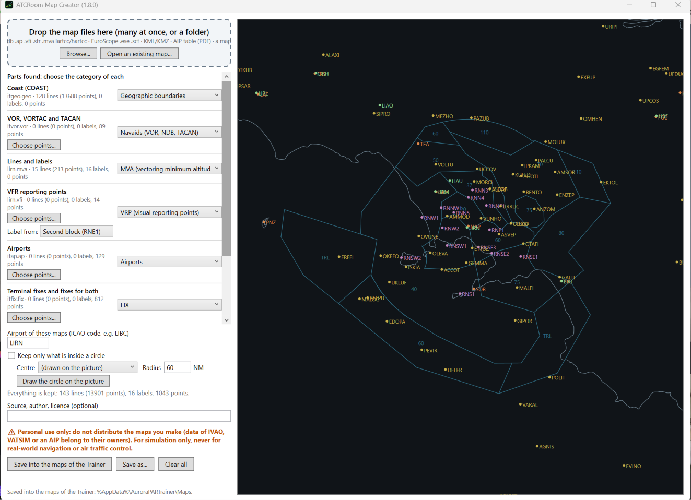
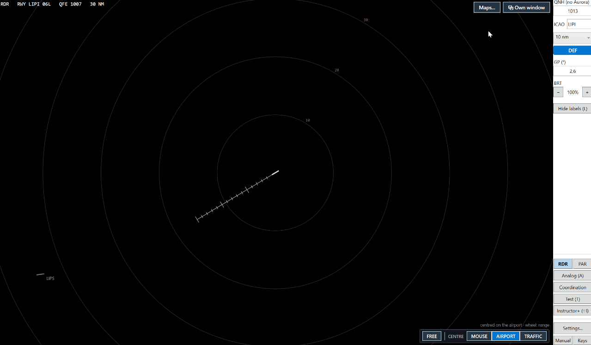

# 5. Maps for the RDR

The surveillance radar (**RDR**) and the Instructor+ draw maps: boundaries, MVA, FIX, VRP, navaids. They are
converted from your own files by **ATCRoom Map Creator** (installed with the Trainer).

> **⚠ Personal use only — simulation only.** The Map Creator reads files of any kind (IVAO, VATSIM, AIP, KML…), but
> the maps you make from them are **for your own use only**: **do not distribute them** (no sharing, no uploading)
> without the permission of the owner of the data. They are for flight simulation and training on AuroraPAR only and
> **must never be used for real-world navigation or air traffic control**.

## Step 1 — Open the Map Creator

Start **ATCRoom Map Creator**, or press **Open ATCRoom Map Creator** in the Maps window of the RDR.

## Step 2 — Drop the files

Drag the files (or a whole folder) into the window: IVAO `.geo .fix .vor .ndb .ap .vfi .str .mva`, EuroScope
`.ese .sct`, KML / KMZ, an AIP table (PDF). A list shows the **parts found**: choose the **category** of each.

## Step 3 — Airport and area

- Write the **ICAO** code of the airport (for example `LIBC`): one file per airport is made. If the file name
  starts with the ICAO, it is filled for you.
- Optional: **Keep only what is inside a circle** (centre, radius in NM; you can draw it on the picture).
- Optional: source, author, licence.

## Step 4 — Save

**Save into the maps of the Trainer** puts the file in the `Maps` folder; **Save as…** chooses another place.
Maps of the same airport are added to its file, replacing only the category you imported.

## Step 5 — Show them on the RDR

On the RDR: **Maps…**. For each category choose **Show**, **Labels** and the colours (kept for each airport).
**Reload** reads the folder again after a change.

The same maps are the ones that offer VRP / FIX / VOR points when you click near them while making a route
([tutorial 2](2-flight-plan.md)).

Next: [macro keyboard](6-macro-keyboard.md).
