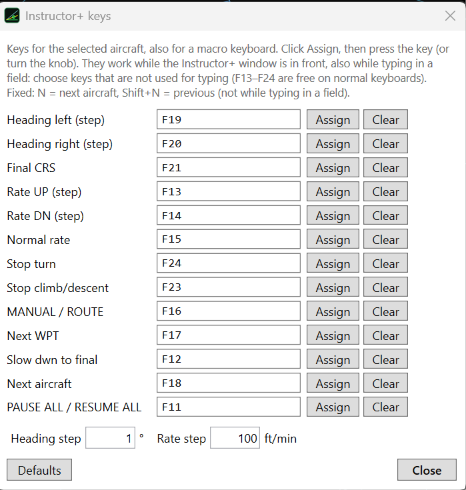

# 6. Macro keyboard

A small keyboard with a few keys and a knob is enough to fly the aircraft while you look at the screen: heading
with the knob, a key for Final CRS, one for Normal rate…

## Step 1 — Program the keyboard

With the software of your macro keyboard, make its keys send **F13 … F21**. Those are the defaults of the Instructor+
(6 keys and a knob, for example: knob left / right = heading, keys = Final CRS, Normal rate, STOP TURN, MANUAL / ROUTE,
Next WPT, Slow dwn to final).

## Step 2 — Open Keys…

On the bar of **AIRCRAFT CONTROL**: **Keys…**. Every command has a row.

## Step 3 — Assign

Click **Assign** on a row, then press the key (or turn the knob). Choose also the **steps** of the heading and rate
keys (for example 1° or 5°).

## Things to know

- The keys work while the Instructor+ window is in front, also while typing in a field: choose keys that you do
  not use for typing.
- Fixed keys: **N** next aircraft, **Shift+N** previous aircraft (not while typing).
- The commands of the keys are carried out after the pilot reaction, like the others.

Next: [tune the aircraft](7-performance.md).
