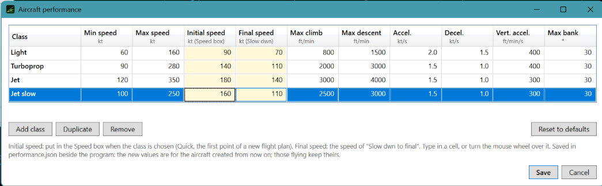

# 7. Tune the aircraft

Every class (Light, Turboprop, Jet) has its own speeds and limits. You can change them, or make new classes.

## Step 1 — Open the table

**Aircraft performance…** in SIMULATION SETTINGS, or **…** beside a Class box.

## Step 2 — Change a value

Type in a cell, or turn the **wheel** over it (Shift: bigger steps). The main columns:

- **Initial speed**: put in the Speed box when the class is chosen.
- **Final speed**: the speed of **Slow dwn to final**.
- **Min / Max speed**: the limits of the speeds you can give.

## Step 3 — Add a class

**Duplicate** a row (for example a slower Jet for a heavy aircraft), change its name and values. **Remove** and
**Reset to defaults** are there too.

## Step 4 — Save

**Save** checks that min ≤ final ≤ initial ≤ max and that no name is repeated. If something is wrong it says what,
and nothing is saved. The values are used for the aircraft created from then on; those already flying keep theirs.

## Step 5 — Use it

Choose the new class in Quick or in a flight plan. During the approach press **Slow dwn to final** (AIRCRAFT CONTROL)
and the aircraft goes to the final speed of its class.

The table is yours: the student's PC does not use it, only the Instructor+ computes the flight. A scenario keeps the
names of the classes, so on another computer make sure the same classes exist.
